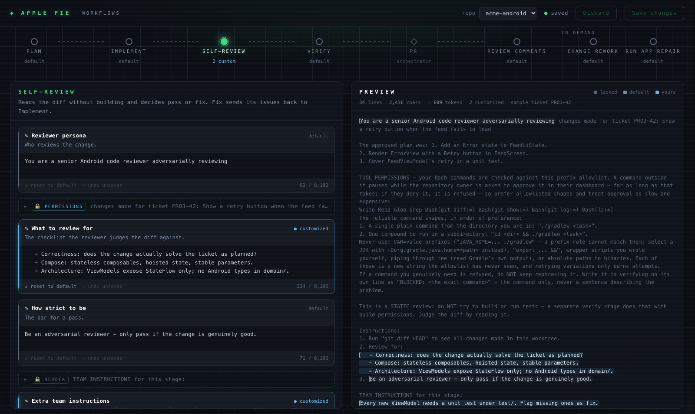

# Customizing workflows

Every stage of a workflow is a prompt that Apple Pie sends to Claude Code. You can rewrite the parts of those prompts that describe *how* your team works: how to plan, your coding rules, what self-review checks, where verify finds your build, how replies to reviewers read. You can't add stages or remove the parts Apple Pie relies on to track a run.

## Opening the editor

- In the TUI, choose **Customize workflows** on the dashboard (or from the `:` palette).
- From the shell, run `pie workflows`. Use `--repo PATH` to open a repo first, or `--no-open` to print the link without opening a browser.

The editor is a page served by `pie` on `127.0.0.1` only. Its link carries a one-time token, and the API refuses requests without it, from another host, or from another site. It closes after 30 minutes idle, when you press Ctrl-C (`pie workflows`), or when you quit the TUI.

## What you see

- **The stage rail.** Plan → Implement → Self-review → Verify → PR → Review comments, plus the on-demand stages Change rework and Run app repair. PR has no prompt, because Apple Pie commits, pushes and opens the PR itself. Each stage shows `default`, how many sections you've customized, or `● unsaved`.
- **The stage, block by block, in the order the agent reads it:**
  - **✎ Editable sections**, with their built-in text pre-filled. Edit them, use **reset to default**, or **undo unsaved**.
  - **Extra team instructions**, an empty section on every stage. Anything you write there goes under a `TEAM INSTRUCTIONS for this stage:` heading, placed before the stage's output contract.
  - **🔒 Locked sections**, collapsed, which you can expand to read.
- **The preview.** The exact prompt the agent receives, built by the same code a run uses, for a sample ticket. Your text is highlighted. Click it to jump to its section.

Save with **Save changes** or <kbd>⌘S</kbd>. The next run of that repo uses the saved workflow; a run already in progress keeps the prompts it started with.

## What you can change

| Stage | Sections |
|---|---|
| Plan | How to plan · When to ask questions · Extra team instructions |
| Implement | Engineer persona · Coding rules · PR description · Extra team instructions |
| Self-review | Reviewer persona · What to review for · How strict to be · Extra team instructions |
| Verify | How to find the build · Extra team instructions |
| Review comments | Engineer persona · How much to change · When to push back · Reply voice · Extra team instructions |
| Change rework | How much to change · Extra team instructions |
| Run app repair | How to investigate (`{serial}` becomes the device serial) · Extra team instructions |

## What stays locked, and why

Apple Pie decides what happens next from files the agent writes, not from what it says. Those files and the rules around them are locked:

- **The output contracts:** `.agent/plan.json`, `report.json`, `review.json`, `comment_fixes.json` and `run.json`, their fields, and the "your final action must be…" instructions.
- **Tool permissions and the `BLOCKED:` convention.** These are what make command approvals work.
- **The spending-limit and device rules.** These cover the one-device queue, `ANDROID_SERIAL`, and never touching your other devices.
- **Verify's certification rules.** It certifies only what it watched pass, never patches the environment, and fixes forward.
- **"Apple Pie owns commit, push and the PR."**
- **The ticket, plan, diff and comment data each stage is given.**

Whatever you write, those parts stay in the prompt word for word; tests check this for every section. The editor also warns, without blocking, when your text contradicts them. For example, telling the agent to skip a contract file, to open a PR itself, or to always mark verification as passed.

## Where it's saved

On this machine, one file per repo: `~/.pie/workflows/<repo>-<hash>.json`. The hash keeps two checkouts with the same folder name apart. The file holds only the sections you changed. A missing or unreadable file means the built-in prompts, so a broken customization never stops a run.
