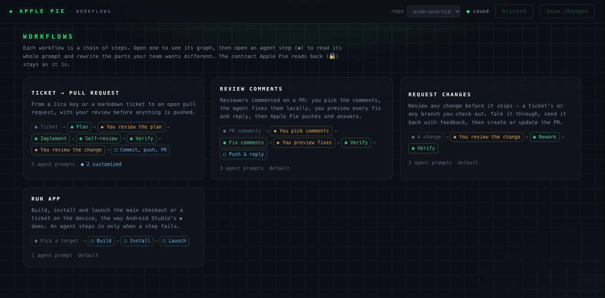

# Customizing workflows

Every stage of a workflow is a prompt that Apple Pie sends to Claude Code. You can rewrite the parts of those prompts that describe *how* your team works: how to plan, your coding rules, what self-review checks, where verify finds your build, how replies to reviewers read. You can't add stages or remove the parts Apple Pie relies on to track a run.

## Opening the editor

- In the TUI, choose **Customize workflows** on the dashboard (or from the `:` palette).
- From the shell, run `pie workflows`. Use `--repo PATH` to open a repo first, or `--no-open` to print the link without opening a browser.

The editor is a page served by `pie` on `127.0.0.1` only. Its link carries a one-time token, and the API refuses requests without it, from another host, or from another site. It closes after 30 minutes idle, when you press Ctrl-C (`pie workflows`), or when you quit the TUI.

## What you see

**Workflows.** The first screen lists the workflows Apple Pie runs. Each card shows its steps and how many of its prompts you've customized:

- **Ticket → pull request**
- **Review comments**
- **Request changes**
- **Run app**

**The graph.** Open a workflow to see its steps as a graph, loops included:

- **◉ Agent steps** run on a prompt. Open one to read and edit it.
- **◆ Your decisions** are where Apple Pie waits for you.
- **▢ Automatic steps** are done by Apple Pie itself, such as commit, push and PR, or build and install.

Verify appears in three workflows. It is one prompt, so an edit there applies to all of them.

**The step.** Click an agent step to see only the fields you can change there. Each field shows:

- **What it controls.**
- **By default:** what Apple Pie does if you leave it alone, in plain words.
- **The text sent to the agent.** Edit it in place, go **back to default**, **undo changes**, or **try an example**.

Every editable step also has an **Extra team instructions** field, empty by default. Anything you write there is added under a `TEAM INSTRUCTIONS for this stage:` heading, before the step's required output.

The fixed steps (Fix round, Revise fixes, Discuss) only pass on your own words, so there's nothing to change in them.

**Show the full prompt**, collapsed at the bottom of each step, shows the exact text the agent receives for a sample ticket, with your fields highlighted.

Save with **Save changes** or <kbd>⌘S</kbd>. The next run of that repo uses the saved workflow; a run already in progress keeps the prompts it started with.

## What you can change

| Stage | Sections |
|---|---|
| Plan | How to plan · When to ask questions · Extra team instructions |
| Implement | Engineer persona · Coding rules · PR description · Extra team instructions |
| Self-review | Reviewer persona · What to review for · How strict to be · Extra team instructions |
| Verify | How to find the build · Extra team instructions |
| Review comments: Fix comments | Engineer persona · How much to change · When to push back · Reply voice · Extra team instructions |
| Request changes: Rework | How much to change · Extra team instructions |
| Run app: Repair | How to investigate (`{serial}` becomes the device serial) · Extra team instructions |

## What stays locked, and why

Apple Pie decides what happens next from files the agent writes, not from what it says. Those files and the rules around them are locked:

- **The output contracts:** `.agent/plan.json`, `report.json`, `review.json`, `comment_fixes.json` and `run.json`, their fields, and the "your final action must be…" instructions.
- **Tool permissions and the `BLOCKED:` convention.** These are what make command approvals work.
- **The spending-limit and device rules.** These cover the one-device queue, `ANDROID_SERIAL`, and never touching your other devices.
- **Verify's certification rules.** It certifies only what it watched pass, never patches the environment, and fixes forward.
- **"Apple Pie owns commit, push and the PR."**
- **The ticket, plan, diff and comment data each stage is given.**

Whatever you write, those parts stay in the prompt word for word; tests check this for every section. The editor also warns, without blocking, when your text contradicts them. For example, telling the agent to skip a contract file, to open a PR itself, or to always mark verification as passed.

## Where it's saved

On this machine, one file per repo: `~/.pie/workflows/<repo>-<hash>.json`. The hash keeps two checkouts with the same folder name apart. The file holds only the sections you changed. A missing or unreadable file means the built-in prompts, so a broken customization never stops a run.
